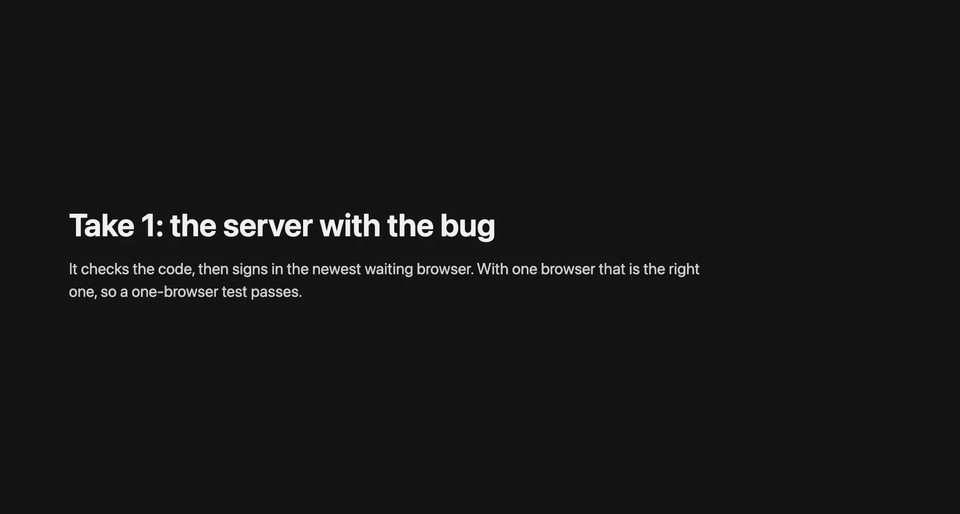
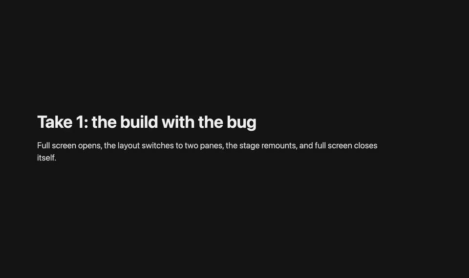
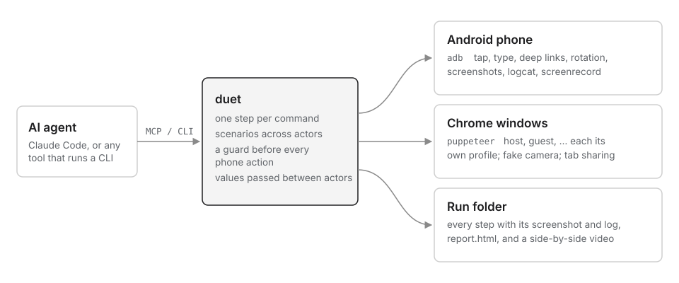
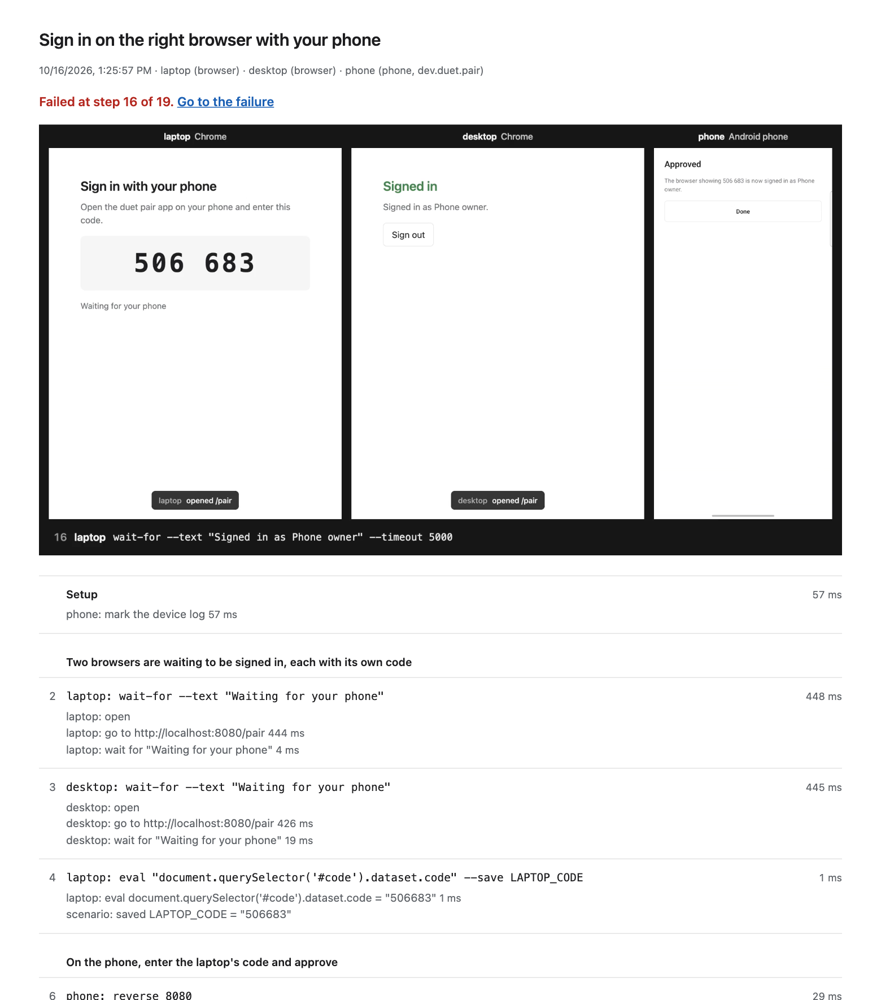

# duet

Lets an AI coding agent test a feature the way a QA person would: on a **real Android phone** and in a **visible browser** at the same time, with a person able to watch every step.

duet is not a testing framework. It is a small harness around adb and Puppeteer. It gives an agent (Claude Code through MCP, or anything that can run a CLI) safe commands that each do one thing, records every step with its screenshot, and keeps the device log at hand. The agent can then find out *why* something failed, fix the code, and run the same steps again.



*Three actors in one test, recorded by duet on a real Android phone. Two browsers wait to be signed in; the phone enters the laptop's code and approves. With the planted bug the desktop gets signed in instead, and the test fails. With the fix it passes. [Full video](docs/media/demo-pairing.mp4) · [the scenario](examples/sign-in-with-phone.yaml)*

> **Status: early (0.1).** Tested end to end on a Samsung Galaxy S24 FE (Android 16) and Chrome 155 on macOS. Other phones and Android versions are untested. The guard fails closed when it cannot read something, so if it misreads your phone, please [open an issue](https://github.com/AdityaSingh-byte/duet/issues) with the output of `duet phone status`.

## Contents

- [Demos](#demos)
- [How it works](#how-it-works)
- [Why](#why)
- [What it does](#what-it-does)
- [Install](#install)
- [Quick start](#quick-start)
- [Use it from Claude Code (MCP)](#use-it-from-claude-code-mcp)
- [Scenarios](#scenarios)
- [Reports and recordings](#reports-and-recordings)
- [Safe on someone's own phone](#safe-on-someones-own-phone)
- [How it compares](#how-it-compares)
- [Things that bit us](#things-that-bit-us)
- [The sample apps](#the-sample-apps)
- [Limits](#limits)
- [Development](#development)
- [Credits](#credits)

## Demos

Both are real runs on an Android phone, recorded by duet itself (`duet scenario run --record`), against small open sample apps with a bug planted on purpose. Each is run twice: with the bug, where the test fails, and with the fix, where the same steps pass.

### Sign in on the right browser: two browsers and a phone

Signing in on the web by approving on your phone, the way messaging apps pair their web versions. A browser shows a 6-digit code; the [duet pair app](sample/pair-app) on the phone enters it and approves; that browser is signed in.

The planted bug (`PAIR_BUG=1` on the [sample server](sample/server)) checks that the code exists, then signs in the *newest* waiting browser. With one browser waiting, that is the right one, so every one-browser test passes. The scenario keeps two browsers waiting, reads the laptop's code with `eval ... --save LAPTOP_CODE`, types it on the phone, and checks that the laptop is signed in and the desktop is not. GIF above; [full video](docs/media/demo-pairing.mp4); [scenario](examples/sign-in-with-phone.yaml).

### Full screen survives turning the phone sideways: a browser and a phone



A host presents a tab from Chrome; a viewer watches on the phone and taps "Full screen". With the bug, the phone turns sideways, the layout switches to two panes, the stage remounts, and full screen closes itself: right after the tap the phone *is* in landscape, and 1.5 s later it is back in portrait. The device log shows `full screen open`, `stage unmounted`, `full screen closed` within 150 ms. [Full video](docs/media/demo-rotation.mp4); [scenario](examples/fullscreen-on-a-phone.yaml).

## How it works



## Why

Some bugs only show up on a real device, in the middle of a flow with more than one person in it.

A viewer on a phone watches a presenter's shared screen and taps "Full screen". The phone turns sideways, and the full-screen view closes itself about 100 ms later. Unit tests and type checks pass. A screenshot after the tap shows that nothing happened. The device log shows what did happen: the view opened, the sideways phone was wider than 600 dp so the layout switched to two panes, the stage remounted and lost its "full screen" state, and the view closed.

Finding that takes two actors (someone presenting from a browser, someone watching on a phone), a real rotation, and the log. duet is built for that loop: act, look, read the log, fix, run it again. The full story is in [docs/story.md](docs/story.md).

## What it does

- **Phone actor.** A real Android device over adb. Screenshots sized for the model, tap by text or by coordinates on the screenshot, deep links, typing, keys, rotation, logcat since a mark, `adb reverse`, and install over the existing app with re-signing. A guard checks the phone before every action.
- **Browser actors.** Any number of named, visible Chrome windows ("host", "guest"), each with its own profile so sign-ins persist. Click by label, fill fields, wait for text, step banners on the page, a fake camera and microphone, and screen sharing of a chosen tab without the picker.
- **Scenarios.** A YAML file whose steps are the same commands, one actor per line. duet stops at the first failure and collects each actor's screenshot and each phone's log.
- **Reports and recordings.** One HTML page per run: every step, its screenshots and log excerpts, with the failure at the top. With `--record`, a video of every actor side by side, captioned with the current step.
- **MCP server.** Every command as a tool. Screenshots come back as images, so the model sees the screen in the tool result.

## Install

You need Node 22.12 or newer, Google Chrome, and for the phone, adb ([Android platform-tools](https://developer.android.com/tools/releases/platform-tools)) with USB debugging turned on.

```sh
npm install -g duet-qa    # the package is duet-qa; the command is duet
duet --help
```

To run the sample apps and the demos, or to change duet itself, work from the source instead (needs [pnpm](https://pnpm.io)):

```sh
git clone https://github.com/AdityaSingh-byte/duet.git
cd duet
pnpm install          # also builds dist/
npm link              # puts this copy's `duet` on your PATH
```

## Quick start

Tell duet which app you are testing. Taps and typing only happen while that app is in front.

```sh
export DUET_PACKAGE=com.example.yourapp
```

### Phone

```sh
duet phone status                    # what is in front, locked or not, would duet act
duet phone launch --shot             # start the app and take a screenshot
duet phone ui                        # elements on screen: label, type, centre
duet phone tap --text "Join"         # by visible text or accessibility label
duet phone tap 362 1452              # by coordinates on the last screenshot
duet phone logs mark                 # remember "now" on the device clock
duet phone tap --text "Full screen"
duet phone rotation --expect landscape --timeout 3000
duet phone logs --since-mark --grep "Dialog|rotation"
duet phone install app-release.apk --resign    # re-sign with the debug key, keep app data
duet phone unstick                   # release a touch another tool left pressed (see below)
```

### Browser

This uses the host page from the [sample](sample), so start its server first: `cd sample/server && npm install && npm start`.

```sh
duet browser open host http://localhost:8080 --capture-title "Slides"
duet browser new-tab host --title "Slides" --text "Slide 1"    # the tab to share
duet browser click host --text "Join room"
duet browser click host --text "Present your screen"           # shares the "Slides" tab, no picker
duet browser wait-for host --text "Presenting a browser tab"
duet browser front host                                        # sharing switched to the Slides tab; come back
duet browser screenshot host
duet browser close host
```

Each browser keeps running between commands. Every command attaches to it, does one thing, records the step and lets go, so an agent can move between the browser and the phone in any order.

Every command prints one JSON object and exits with a code that says what happened: `0` ok, `1` failed, `2` usage, `3` refused by the guard, `4` device problem, `5` not found, `6` timed out. Run `duet --help` for every command and option.

## Use it from Claude Code (MCP)

```sh
claude mcp add duet -e DUET_PACKAGE=com.example.yourapp -- duet mcp
```

Or in any MCP client's config:

```json
{
  "mcpServers": {
    "duet": {
      "command": "duet",
      "args": ["mcp"],
      "env": { "DUET_PACKAGE": "com.example.yourapp" }
    }
  }
}
```

Without a global install, use `npx -y -p duet-qa duet mcp` as the command.

The tools mirror the CLI: `phone_status`, `phone_screenshot`, `phone_tap`, `phone_logs`, `browser_open`, `browser_click`, `scenario_run`, `report_build` and the rest. Screenshots are scaled so that coordinates the model reads off the image can be passed straight to `phone_tap`. The server keeps the phone and the browsers attached between calls.

## Scenarios

A scenario names its actors, then lists steps as `actor: command`, using the same commands as the CLI.

```yaml
name: Full screen survives turning the phone sideways
actors:
  host:
    browser:
      url: ${SAMPLE_URL:-http://localhost:8080}
      captureTitle: Slides for the phone
  viewer:
    phone:
      package: dev.duet.sample
steps: |
  note: The host presents a slides tab
  host: new-tab --title "Slides for the phone" --text "Slide 1"
  host: click --text "Join room"
  host: click --text "Present your screen"
  note: The viewer joins on the phone and goes full screen
  viewer: reverse 8080
  viewer: open-link "duetsample://room/demo"
  viewer: tap --text "Join demo"
  viewer: logs mark
  viewer: tap --text "Full screen"
  viewer: rotation --expect landscape --timeout 3000
  pause: 1500
  viewer: rotation --expect landscape
  viewer: logs --since-mark --grep duet-sample
```

```sh
duet scenario check examples/fullscreen-on-a-phone.yaml    # validate; touches no device
duet scenario run examples/fullscreen-on-a-phone.yaml      # writes runs/<time>-<name>/report.html
duet scenario run examples/fullscreen-on-a-phone.yaml --record --pace 900   # and video/run.mp4
```

- Because the steps are the commands an agent already uses, a sequence it worked out by hand can be saved and replayed after every fix.
- `note:` lines become headings in the report. `pause: MS` waits; prefer `wait-for`, and keep `pause` for "it should still be like this a moment later".
- `${VAR}` comes from the environment, and `${SCENARIO_DIR}` is the scenario's folder. An unset variable is an error unless it has a fallback: `${VAR:-fallback}`.
- Values can pass between actors. `eval EXPR --save NAME` on a browser step keeps the result, and later steps use it as `${NAME}`: a sign-in code, a room link, an invite id. duet checks before the run that nothing is used before it is saved.

  ```yaml
  steps: |
    laptop: eval "document.querySelector('#code').dataset.code" --save LAPTOP_CODE
    phone: type ${LAPTOP_CODE}
  ```
- Browsers the scenario started are closed at the end. Pass `--keep-open` to leave them up.
- `--pace MS` waits before each action, so a person or a recording can follow. It never delays a check (`wait-for`, `rotation`, `logs`, `screenshot`), so pacing cannot change a result.

There are two examples in [examples/](examples): a browser-only one that runs anywhere (`share-a-tab.yaml`) and the two-actor phone demo (`fullscreen-on-a-phone.yaml`).

## Reports and recordings

Every step goes to `events.jsonl` in the run folder: actor, action, arguments, result or error, duration, and the screenshot or log file it produced. `duet report [RUN_DIR]` turns a folder into `report.html`. Pass `--inline` to embed the screenshots and get a single file you can send. A scenario run writes its report automatically.

`duet scenario run FILE --record` also records every actor while it runs: each phone with Android's own `screenrecord`, each browser through Chrome's screencast. It then joins them side by side into `video/run.mp4`, lined up in time, with the current step as a caption and the result at the end, and the report shows it at the top. Add `--gif` for a GIF too, and run `duet video RUN_DIR` to rebuild the video later. It needs ffmpeg.

The phone recording only starts if the guard allows looking at the screen, and the phone's status bar (your notification icons) is cropped out of the video. Android stops `screenrecord` after 3 minutes.



## Safe on someone's own phone

A test phone is often the developer's own phone, in use while the agent works. Before every command duet reads what is in front, and whether the phone is awake and unlocked:

| | your app in front | home screen | another app, locked, asleep, or the shade is down |
|---|---|---|---|
| look (screenshot, ui, wait-for) | yes | yes | no |
| launch (open-link, launch) | yes | yes | no |
| act (tap, swipe, type, keys) | yes | no | no |

- Anything it cannot read counts as unsafe.
- Screenshots are refused while another app is in front, so the agent never captures someone's messages.
- `install` never uninstalls, because that would wipe the app's data and sign-in.
- `logs` reads logcat without clearing it. It covers the whole device, because system lines such as rotation changes are often the clue. Pass `--app` to keep only your app's lines.
- `--no-guard` turns the checks off, for a dedicated lab device.

## How it compares

Plenty of tools already let an agent drive one surface:

- [Maestro MCP](https://maestro.dev/mcp) lets an agent write and run YAML flows on an emulator or simulator.
- [Playwright MCP](https://github.com/microsoft/playwright-mcp) drives a browser.
- There are many adb-based Android MCP servers, such as [Android-MCP](https://github.com/CursorTouch/Android-MCP) and [adb-mcp](https://github.com/FlashZ/adb-mcp).

If one surface is enough, use one of them. duet is for the case they leave to you: **several actors in one scenario** (a host in a browser, a viewer on a phone), on a **real phone that may be someone's own**, **watchable** while it runs, with the **device log** next to every failure.

## Things that bit us

- **Scaled screenshots.** A model sees a large screenshot scaled down (a 1080x2340 capture can arrive as 923x2000), so coordinates read off it are not device pixels. duet saves screenshots already scaled (1568 px on the long edge by default), records the scale, and maps taps back. If the screen has rotated since the screenshot, the tap is refused.
- **"Nothing happened" is often wrong.** A view that opens and closes within 100 ms never shows up in a screenshot. The log has it.
- **Chrome's fake media flags can fake your screen share.** `--use-fake-ui-for-media-stream` skips the screen-share picker and shares a fake green test pattern, so `--auto-select-tab-capture-source-by-title` never takes effect. When a capture tab is named, duet auto-accepts only the camera and microphone.
- **A window behind other windows is slow.** macOS reports it as hidden and Chrome runs its timers once a second. A host sharing frames dropped to one a second while the person watched the phone. duet launches Chrome with that throttling off.
- **uiautomator has blind spots.** It cannot read a screen that never goes idle (live video, endless animation), and it misses some overlays. Fall back to a screenshot and coordinates.
- **Signatures.** A release APK signed with a different key will not install over the existing app. Re-sign it with the key the installed copy uses (`install --resign`) rather than uninstalling.
- **A ghost finger.** An automation tool killed in the middle of a gesture can leave an injected touch pressed. From then on Android rejects every injected tap ("pointers already down"), while `adb shell input tap` still exits 0. That is what we found on our test phone the first time duet ran on it. duet checks the input dispatcher's verdict after every tap and fails with its reason, and `duet phone unstick` releases the stuck pointer with a small helper ([android/unstick](android/unstick/Unstick.java)), because `input` can only send pointer 0.
- **A page that sits still records nothing.** Chrome's screencast only sends a frame when the page changes, so a browser that just waits (the desktop in the sign-in demo) came out as an empty file. While recording, duet keeps a 2 px, nearly invisible element moving so frames keep coming.
- **Sharing a tab switches to it.** When a page shares another tab, Chrome brings the shared tab to the front, and the presenter's page stops being drawn (and recorded). `duet browser front` brings it back; the shared tab keeps streaming from the background.

## The sample apps

[sample/](sample) holds everything the demos run against, with no outside accounts or services:

- [sample/server](sample/server): one small Node server for both demos. It relays a host's shared tab to viewers, and serves the sign-in page and its API. `PAIR_BUG=1` plants the sign-in bug.
- [sample/app](sample/app): the room viewer (Expo, `dev.duet.sample`). The full-screen bug is planted on the `demo/rotation-bug` branch and fixed on `main`.
- [sample/pair-app](sample/pair-app): the duet pair app (Expo, `dev.duet.pair`) that enters a code and approves a browser.

See [sample/README.md](sample/README.md) to run them.

## Limits

- Android only. One phone per phone actor. Chrome only.
- Recording a phone keeps the portrait frame, so a landscape screen appears smaller inside it.
- `type` sends ASCII only (an `adb shell input` limit).
- The guard reads `dumpsys` output, whose format varies by Android version and vendor. It fails closed when it cannot parse something.

## Development

```sh
pnpm install
pnpm typecheck
pnpm test        # unit tests, plus a check that this README matches the CLI
pnpm build
```

The tests never touch a device or launch Chrome; the phone is simulated. To rebuild the unstick helper (`assets/duet-unstick.dex`), run `scripts/build-unstick.sh` with `ANDROID_HOME` and a JDK. `test/readme.test.ts` checks that every `duet` command in this README is a real command with real options, that the scenario example above loads, and that the links to files in this repo exist. See [CONTRIBUTING.md](CONTRIBUTING.md).

## Credits

Made by [Aditya Singh](https://github.com/AdityaSingh-byte), built with [Claude Code](https://claude.com/claude-code). It grew out of testing a live video feature on a real phone with an agent, and was rewritten from scratch as a general tool.

Built on [adb](https://developer.android.com/tools/adb), [Puppeteer](https://pptr.dev), [ffmpeg](https://ffmpeg.org), the [Model Context Protocol SDK](https://github.com/modelcontextprotocol/typescript-sdk), [pngjs](https://github.com/pngjs/pngjs), [yaml](https://github.com/eemeli/yaml) and [zod](https://zod.dev). The sample viewer app started from [Expo](https://expo.dev)'s blank template, and the sample relay uses [ws](https://github.com/websockets/ws).

## License

[MIT](LICENSE). Copyright (c) 2026 Aditya Singh.
